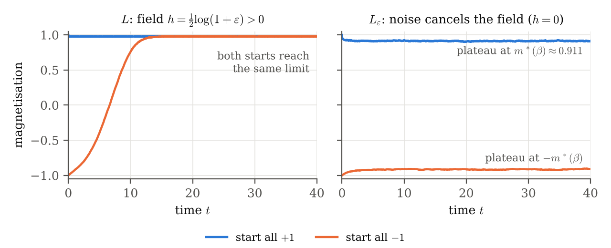

# Directed noise can destroy ergodicity — digest

**Status:** `plausible`  
**Verified by:** — (awaiting human check)  
**AI involvement:** idea by Jonas Köppl (recalled from an earlier, unrecorded discussion); construction and proofs written out by Claude (Opus 5.5); see `raw/`  
**PDF:** [`pdf/0003-directed-noise-cancels-ising-field.pdf`](../../pdf/0003-directed-noise-cancels-ising-field.pdf)  

## Setting

Spins: $\eta \in \{0,1\}^{\mathbb{Z}^d}$, with $0 \leftrightarrow -1$ and $1 \leftrightarrow +1$. For $x \in \mathbb{Z}^d$ let
$$S_x(\eta) := \sum_{y : |y - x| = 1} \big(2\eta(y) - 1\big)$$
be the sum of the neighbouring spins. For $\beta \ge 0$ and $h \in \mathbb{R}$ let $L^{\beta,h}$ be the spin system with rates
$$c_1(x,\eta) = e^{2\beta S_x(\eta) + 2h} \quad (-1 \to +1), \qquad c_0(x,\eta) = 1 \quad (+1 \to -1).$$
The down-rate is **constant**; this is *not* Glauber (heat-bath) dynamics. The rates are nearest-neighbour, translation invariant and positive; $c_1$ is increasing and $c_0$ is constant, so $L^{\beta,h}$ is monotone in the sense of Bérard–Dembin–Marêché, and $\mathbf 0$ is not absorbing.

## Key identity: directed noise is a field

Adding noise towards $0$ turns $c_0 = 1$ into $c_0 = 1 + \varepsilon$, so
$$\big(L^{\beta,h}\big)_\varepsilon = (1 + \varepsilon)\, L^{\beta,\, h - \frac12 \log(1+\varepsilon)}.$$
Up to a constant time change, directed noise of strength $\varepsilon$ **lowers the external field** by $\tfrac12 \log(1 + \varepsilon)$. (Compare the rates: both sides have $c_1 = e^{2\beta S_x + 2h}$ and $c_0 = 1 + \varepsilon$.)

## Statement

**Proposition.** Let $d \ge 2$, $\beta > \beta_c(d)$ (the critical inverse temperature of the nearest-neighbour Ising model), $\varepsilon > 0$, and let
$$L := L^{\beta, h}, \qquad h := \tfrac12 \log(1 + \varepsilon) > 0,$$
i.e. $c_1(x,\eta) = (1+\varepsilon)\, e^{2\beta S_x(\eta)}$ and $c_0 \equiv 1$. Then:

1. $L$ is monotone, finite range, with positive rates, and **ergodic**.
2. $L_\varepsilon = (1+\varepsilon) L^{\beta,0}$ is **not ergodic**: the plus and minus Ising Gibbs measures $\mu^+_{\beta,0} \neq \mu^-_{\beta,0}$ are both stationary (indeed reversible).
3. For every $\varepsilon' \ge 0$ with $\varepsilon' \neq \varepsilon$, $L_{\varepsilon'}$ is ergodic. So $\{\varepsilon' \ge 0 : L_{\varepsilon'} \text{ ergodic}\} = [0,\infty) \setminus \{\varepsilon\}$.

So the naive generalisation in `question.md` fails, already for plain ergodicity: the hypothesis "$\mathbf 0$ is absorbing" in Theorem 1.1 of Bérard–Dembin–Marêché cannot simply be dropped.

**Concrete instance.** $d = 2$, $\beta = \tfrac12 > \beta_c = \tfrac12\log(1+\sqrt2) \approx 0.441$, $\varepsilon = 1$: flip $+1 \to -1$ at rate $1$ and $-1 \to +1$ at rate $2e^{S_x}$. This is ergodic; adding rate-$1$ noise towards $-1$ makes it non-ergodic.

## Proof

**Step 1: Gibbs measures are reversible.** $L^{\beta,h}$ is a stochastic Ising model for the nearest-neighbour ferromagnet with field $h$. In $\pm1$ notation the flip rate $c(x,\sigma)$ satisfies
$$c(x,\sigma)\, e^{\sigma_x(\beta S_x + h)} = e^{\beta S_x + h},$$
which does not depend on $\sigma_x$; equivalently $c_1 / c_0 = e^{2\beta S_x + 2h}$ is the ratio of the Gibbs weights after and before the flip. Hence every Gibbs measure for $(\beta, h)$ is reversible, and in particular stationary, for $L^{\beta,h}$ (Liggett 1985, Ch. IV, Sect. 2).

**Step 2: sandwich.** $L^{\beta,h}$ is attractive, so the lower and upper invariant measures $\underline\nu = \lim_t \delta_{\mathbf 0} S(t)$ and $\overline\nu = \lim_t \delta_{\mathbf 1} S(t)$ exist, and the process is ergodic iff $\underline\nu = \overline\nu$ (Liggett 1985, Ch. III, Sect. 2). Compare the process started from $\mathbf 1$ with the dynamics in a box $\Lambda$ with spins outside $\Lambda$ frozen at $+1$. The frozen system has larger up-rates and smaller down-rates, so by the comparison theorem for attractive spin systems (Liggett 1985, Ch. III, Sect. 1) it stays above the original one. It is a finite irreducible chain, reversible with respect to the finite-volume Gibbs measure $\mu^+_{\Lambda}$ with plus boundary condition, so it converges to $\mu^+_\Lambda$. Letting $t \to \infty$ and then $\Lambda \uparrow \mathbb{Z}^d$ gives $\overline\nu \le \mu^+_{\beta,h}$; symmetrically $\underline\nu \ge \mu^-_{\beta,h}$. Hence
$$\mu^-_{\beta,h} \le \underline\nu \le \overline\nu \le \mu^+_{\beta,h}.$$

**Step 3: conclusion.**

- For $h \neq 0$ the Gibbs measure is unique at every $\beta$ (Lee–Yang 1952 with Lebowitz–Martin-Löf 1972), so $\mu^+_{\beta,h} = \mu^-_{\beta,h}$, and the sandwich forces $\underline\nu = \overline\nu$. This gives ergodicity of $L = L^{\beta, \frac12\log(1+\varepsilon)}$, and of $L_{\varepsilon'} = (1+\varepsilon')L^{\beta, h'}$ with $h' = \tfrac12 \log\frac{1+\varepsilon}{1+\varepsilon'} \neq 0$ for $\varepsilon' \neq \varepsilon$.
- For $h = 0$ and $\beta > \beta_c(d)$, $d \ge 2$, there is a phase transition: $\mu^+_{\beta,0} \neq \mu^-_{\beta,0}$ (Peierls 1936). By Step 1 both are stationary for $L^{\beta,0}$, hence for $L_\varepsilon = (1+\varepsilon)L^{\beta,0}$, which is therefore not ergodic. $\square$

**Remark (avoiding Lee–Yang).** The pressure is convex in $h$, so it is differentiable at all but countably many $h$, and at those $h$ the Gibbs measure is unique (Lebowitz–Martin-Löf). This already gives the counterexample for all but countably many $\varepsilon > 0$, which is enough to refute the claim.

## Simulation

$200 \times 200$ torus, $\beta = \tfrac12$, $\varepsilon = 1$, started from all $+1$ and all $-1$ (code in `code/simulate.py`). Under $L$ both starts reach the same limit; under $L_\varepsilon$ they stay at the two Onsager–Yang values $\pm m^*(\beta) \approx \pm 0.911$. On a finite torus every chain is ergodic, so the plateaux are metastable states; the picture illustrates the proposition, it does not prove it.

## Mechanism

**Directed noise is a field.** Because the down-rate is constant, extra down-flips at rate $\varepsilon$ only rescale it, and a rescaled ratio $c_1/c_0$ is exactly a shift of the external field. The ergodic system $L$ sits at field $h > 0$; the noise moves it to $h = 0$, which for $\beta > \beta_c$ is the phase-coexistence line, where the system is not ergodic.

In the absorbing case the noise pushes towards the unique stationary measure $\delta_{\mathbf 0}$, and the set of ergodic systems is closed under adding noise. Without an absorbing state, the non-ergodic set can lie *between* $L$ and $L_\varepsilon$, and noise in one direction can cross it. In particular ergodicity is **not monotone in the noise strength**: here it fails at exactly one value $\varepsilon$.

**Why not Glauber dynamics?** For heat-bath rates $c_0$ depends on $S_x$, so $c_1/(c_0 + \varepsilon)$ is no longer of the form $e^{2\beta' S_x + 2h'}$. The perturbed system is then not a stochastic Ising model, and nothing is known about its stationary measures. The constant down-rate is what makes the cancellation exact.

**Spin-flipped version.** Conjugating by $\eta \mapsto \mathbf 1 - \eta$ gives the same construction with noise towards $+1$: the rate $-1 \to +1$ is constant and the rate $+1 \to -1$ is $(1+\varepsilon)e^{-2\beta S_x}$. For noise towards $0$, as in Bérard–Dembin–Marêché, the constant rate must be the one pointing in the direction of the noise.

## Which hypothesis breaks

- **$\mathbf 0$ absorbing:** here $c_1(\mathbf 0) = (1+\varepsilon)e^{-4d\beta} > 0$.
- **Dimension:** a phase transition is needed, so $d \ge 2$.

## What this does *not* show

The open question in Section 1.5 of Bérard–Dembin–Marêché asks for *some* arbitrarily small perturbation that is exponentially ergodic. For the $L$ above, $L_{\varepsilon'}$ is ergodic for all $\varepsilon' < \varepsilon$, so the example does not answer it; see `followups.md`.

## Assessment of the raw output

The recollection in `raw/` contains the whole idea: cancel the field by directed noise, use rates with one constant rate instead of Glauber rates, and use the phase transition at zero field. The details added in this session are the time-change identity, the ergodicity argument for $L$ (sandwich plus uniqueness for $h \neq 0$), the observation that ergodicity fails only at $\varepsilon' = \varepsilon$, and the direction convention (constant rate in the direction of the noise). No human check yet.

## References

- J. Bérard, B. Dembin, L. Marêché, Sharpness for monotone absorbing interacting particle systems, arXiv:2510.11424 (2025).
- I. Hartarsky, Bootstrap percolation, probabilistic cellular automata and sharpness, *J. Stat. Phys.* 187 (2022).
- T. M. Liggett, *Interacting Particle Systems*, Springer, 1985, Ch. III and IV.
- T. D. Lee, C. N. Yang, Statistical theory of equations of state and phase transitions II: Lattice gas and Ising model, *Phys. Rev.* 87 (1952).
- J. L. Lebowitz, A. Martin-Löf, On the uniqueness of the equilibrium state for Ising spin systems, *Comm. Math. Phys.* 25 (1972).
- R. Peierls, On Ising's model of ferromagnetism, *Proc. Cambridge Philos. Soc.* 32 (1936).
- C. N. Yang, The spontaneous magnetization of a two-dimensional Ising model, *Phys. Rev.* 85 (1952).
- S. Friedli, Y. Velenik, *Statistical Mechanics of Lattice Systems*, Cambridge University Press, 2017, Ch. 3.
